# Guía de Arquitectura y Extensión para Agentes y Desarrolladores: `ndhSurvival`

Bienvenido a la documentación técnica de **ndhSurvival**. Este archivo sirve como manual maestro para desarrolladores y agentes autónomos de IA que necesiten mantener, refactorizar o extender las funcionalidades del plugin.

---

## 1. Visión General de la Arquitectura

`ndhSurvival` es un plugin modular para servidores Paper/Purpur (Minecraft 1.21.4+, compilado con Java 25) diseñado bajo los principios de **responsabilidad única (SRP)**, **alta cohesión** y **bajo acoplamiento**.

```mermaid
graph TD
    Plugin["NdhSurvivalPlugin"] --> MM["ModuleManager"]
    Plugin --> CR["NdhCommandRouter (/ndh)"]
    
    MM --> M1["CreeperAskModule"]
    MM --> M2["InvSeeModule"]
    MM --> M3["JoinTgModule"]
    MM --> M4["BarrenderoModule"]
    MM --> M5["ShareStatsModule"]
    MM --> M6["RtpModule"]
    MM --> MX["Futuro Módulo..."]

    CR --> C1["AyudaSubCommand ('ayuda')"]
    CR --> C2["EstadoSubCommand ('estado')"]
    CR --> C3["RecargarSubCommand ('recargar')"]
    CR --> C4["CreeperSubCommand ('creeper')"]
    CR --> C5["BarrenderoSubCommand ('barrendero')"]
    CR --> C6["InventarioSubCommand ('inventario')"]
    CR --> C7["EnderChestSubCommand ('enderchest')"]
    CR --> C8["TelegramSubCommand ('telegram')"]
    CR --> C9["ShareStatsSubCommand ('estadisticas')"]
    CR --> C10["RtpAdminSubCommand ('rtp')"]
```

Todas las funciones survival coexisten bajo un comando paraguas unificado: **`/ndh <subcomando>`**.



---

## 2. Reglas de Diseño Mandatorias

Al modificar código o añadir nuevas funciones, **todo desarrollador o agente de IA debe cumplir obligatoriamente** con las siguientes reglas:

### Regla 1: Autocompletado Canónico en Español (1 Única Palabra)
- El autocompletado de primer nivel de `/ndh ` (`args.length == 1`) **SOLO** debe sugerir el nombre canónico del subcomando en **español** y en una **única palabra**.
- **Prohibido**: Sugerir múltiples palabras que hagan lo mismo (ej. nunca sugerir a la vez `inv`, `invsee`, `openinv`, `inventario`).
- Los alias (`getAliases()`) se reservan exclusivamente para **compatibilidad de ejecución manual** si un usuario antiguo o script los escribe, pero el TabCompleter nunca los devuelve.
- Los sub-argumentos (`args.length >= 2`) deben sugerirse en español (ej: `activar`, `desactivar`, `estado`, `recargar`, `limpiar`, `todos`).

### Regla 2: Principio de Responsabilidad Única (SRP)
- **`SurvivalModule`**: Solo gestiona el ciclo de vida (`onEnable`, `onDisable`, `onReload`, `isEnabled`, `getId`, `getDisplayName`).
- **`NdhSubCommand`**: Cada comando reside en su propia clase dedicada dentro del paquete `command` del módulo. No mezclar interfaces de comando en la clase del módulo.
- **`Listener`**: Los escuchadores de eventos Bukkit/Paper residen en clases independientes dentro del paquete `listener`.

### Regla 3: Adventure / MiniMessage
- Todos los textos enviados al usuario deben formatearse con **Kyori Adventure `MiniMessage`** o componentes nativos de Adventure. Evitar el uso obsoleto de `ChatColor` con códigos `&` o `§`.

### Regla 4: APIs Modernas de Paper
- No usar métodos obsoletos de Bukkit (ej: usar `player.getAttribute(Attribute.MAX_HEALTH)` en vez de `player.getMaxHealth()`, `player.teleportAsync()` en vez de llamadas síncronas bloqueantes, etc.).

---

## 3. Estructura de Paquetes

```
dev.ndh.survival/
├── NdhSurvivalPlugin.java               # Entrada principal del plugin
├── core/
│   ├── command/
│   │   ├── NdhCommandRouter.java        # Router central y autocompletador estricto
│   │   ├── NdhSubCommand.java           # Interfaz base de subcomandos
│   │   └── impl/                        # Subcomandos centrales (ayuda, estado, recargar)
│   └── module/
│       ├── ModuleManager.java           # Gestor del ciclo de vida de los módulos
│       └── SurvivalModule.java          # Contrato que implementa cada módulo
└── modules/
    ├── barrendero/                      # Módulo de limpieza de items del suelo
    ├── creeperask/                      # Módulo de confirmación previa a explosión de creepers
    ├── invsee/                          # Inspección de inventarios y enderchest
    ├── jointg/                          # Notificaciones de Telegram y bienvenida
    ├── rtp/                             # Teletransporte aleatorio seguro
    ├── sharestats/                      # Sincronización global de salud/hambre/efectos
    └── <nuevo_modulo>/                  # Nuevas funciones
```

---

## 4. Guía Paso a Paso: Cómo Añadir una Nueva Función o Módulo

Sigue este procedimiento exacto para incorporar cualquier nueva funcionalidad al servidor.

### Paso 1: Crear la estructura de paquetes
Crea una carpeta dentro de `dev.ndh.survival.modules` con el nombre de tu módulo en minúsculas, por ejemplo `mochila`:
```
dev/ndh/survival/modules/mochila/
├── MochilaModule.java
├── command/
│   └── MochilaSubCommand.java
└── listener/
    └── MochilaListener.java
```

### Paso 2: Crear el Subcomando (`NdhSubCommand`)
Crea la clase del comando implementando `NdhSubCommand`. Asegúrate de que `getName()` sea una **única palabra en español**:

```java
package dev.ndh.survival.modules.mochila.command;

import dev.ndh.survival.core.command.NdhSubCommand;
import dev.ndh.survival.modules.mochila.MochilaModule;
import net.kyori.adventure.text.minimessage.MiniMessage;
import org.bukkit.command.CommandSender;
import org.jetbrains.annotations.NotNull;
import org.jetbrains.annotations.Nullable;

import java.util.List;
import java.util.Locale;

public final class MochilaSubCommand implements NdhSubCommand {

    private static final MiniMessage MINI = MiniMessage.miniMessage();
    private final MochilaModule module;

    public MochilaSubCommand(MochilaModule module) {
        this.module = module;
    }

    @Override
    public @NotNull String getName() {
        return "mochila"; // Palabra canónica única en español
    }

    @Override
    public @NotNull List<String> getAliases() {
        return List.of("backpack", "bolso"); // Solo para ejecución de respaldo
    }

    @Override
    public @NotNull String getDescription() {
        return "Abre o administra la mochila virtual del jugador.";
    }

    @Override
    public @NotNull String getUsage() {
        return "/ndh mochila <abrir|estado|recargar>";
    }

    @Override
    public @Nullable String getPermission() {
        return "ndh.mochila.use";
    }

    @Override
    public void execute(@NotNull CommandSender sender, @NotNull String label, @NotNull String[] args) {
        if (args.length == 0 || args[0].equalsIgnoreCase("abrir")) {
            // Lógica de apertura
            sender.sendMessage(MINI.deserialize("<green>Abriendo mochila...</green>"));
            return;
        }

        String sub = args[0].toLowerCase(Locale.ROOT);
        if (sub.equals("estado")) {
            sender.sendMessage(MINI.deserialize("<yellow>Mochila activa: " + module.isEnabled() + "</yellow>"));
            return;
        }

        sender.sendMessage(MINI.deserialize("<red>Uso: " + getUsage() + "</red>"));
    }

    @Override
    public @NotNull List<String> tabComplete(@NotNull CommandSender sender, @NotNull String alias, @NotNull String[] args) {
        if (args.length == 1) {
            String prefix = args[0].toLowerCase(Locale.ROOT);
            return List.of("abrir", "estado", "recargar").stream()
                    .filter(opt -> opt.startsWith(prefix))
                    .toList();
        }
        return List.of();
    }
}
```

### Paso 3: Crear el Módulo (`SurvivalModule`)
Crea la clase del módulo encargada de inicializar servicios, registrar subcomandos y listeners:

```java
package dev.ndh.survival.modules.mochila;

import dev.ndh.survival.NdhSurvivalPlugin;
import dev.ndh.survival.core.module.SurvivalModule;
import dev.ndh.survival.modules.mochila.command.MochilaSubCommand;

public final class MochilaModule implements SurvivalModule {

    private final NdhSurvivalPlugin plugin;
    private boolean enabled;

    public MochilaModule(NdhSurvivalPlugin plugin) {
        this.plugin = plugin;
    }

    public NdhSurvivalPlugin getPlugin() {
        return plugin;
    }

    @Override
    public String getId() {
        return "mochila";
    }

    @Override
    public String getDisplayName() {
        return "Mochilas Virtuales";
    }

    @Override
    public String getDescription() {
        return "Proporciona mochilas virtuales a los jugadores.";
    }

    @Override
    public void onEnable() {
        this.enabled = plugin.getConfig().getBoolean("mochila.enabled", true);
        
        // Registrar subcomando en el router central
        plugin.getCommandRouter().registerSubCommand(new MochilaSubCommand(this));
    }

    @Override
    public void onDisable() {
        // Liberar recursos o guardar datos pendientes
    }

    @Override
    public void onReload() {
        this.enabled = plugin.getConfig().getBoolean("mochila.enabled", true);
    }

    @Override
    public boolean isEnabled() {
        return enabled;
    }
}
```

### Paso 4: Declarar Configuración y Permisos
1. En `src/main/resources/config.yml`:
   ```yaml
   mochila:
     enabled: true
     size: 27
   ```
2. En `src/main/resources/plugin.yml`:
   Añade el permiso correspondiente bajo `permissions` e inclúyelo en `ndh.admin` si corresponde:
   ```yaml
   permissions:
     ndh.admin:
       children:
         ndh.mochila.use: true
     ndh.mochila.use:
       description: Permite usar la mochila virtual.
       default: true
   ```

### Paso 5: Registrar el Módulo en el Plugin Principal
Edita `dev/ndh/survival/NdhSurvivalPlugin.java` y añade tu módulo en el método `registerModules()`:

```java
    private void registerModules() {
        moduleManager.registerModule(new CreeperAskModule(this));
        moduleManager.registerModule(new InvSeeModule(this));
        moduleManager.registerModule(new JoinTgModule(this));
        moduleManager.registerModule(new BarrenderoModule(this));
        moduleManager.registerModule(new ShareStatsModule(this));
        moduleManager.registerModule(new RtpModule(this));
        moduleManager.registerModule(new MochilaModule(this)); // <-- Tu nuevo módulo
    }
```

---

## 5. Compilación y Validación

Ejecuta siempre los siguientes comandos Maven antes de dar una tarea por terminada:

```powershell
# Compilar y validar que no haya errores de tipos ni de deprecations
mvn clean compile "-Dmaven.compiler.showDeprecation=true"

# Ejecutar la suite de tests unitarios
mvn test

# Empaquetar el JAR final listo para producción
mvn clean package
```

El artefacto generado se ubicará en `target/ndhSurvival-1.0.0.jar`.

---

## 6. Nulabilidad (JSpecify) y el análisis de `null` del IDE

**Qué pasa:** Paper API 26.1 se publica con anotaciones **JSpecify** (`org.jspecify.annotations.NullMarked`) en sus paquetes `io.papermc.*`. Al abrir el proyecto en VS Code, el Language Server de Java (Eclipse JDT) activa automáticamente su análisis de nulabilidad (`java.compile.nullAnalysis.mode`), y entonces cada interacción entre **nuestro código** y las clases anotadas de Paper genera avisos del tipo:

- `Null type safety (type annotations): The expression of type 'Sound' needs unchecked conversion to conform to '@NonNull Sound'`
- `Unsafe null type conversion (type annotations): ... Optional<@NonNull Creeper> ... less-annotated type Optional<Creeper>`
- `Potential null pointer access ... capture#1-of ? extends Player` (falso positivo de `Collection<? extends Player>`)

**Por qué no se pueden "arreglar" todos:** Bukkit (`org.bukkit.*`), Adventure/Examiner y el propio JDK **no** están anotados con JSpecify. JDT solo puede validar conversiones entre tipos anotados, así que:

| Estado | Avisos |
|---|---|
| Código sin `@NullMarked` (actual) | ~28, todos en fronteras con Paper |
| Código con `@NullMarked` en todos los paquetes | ~221, porque cada uso de JDK/Bukkit pasa a ser conversión no verificada |

Por eso la decisión del proyecto es:

1. **Usar JSpecify en nuestro código** (`org.jspecify:jspecify` como dependencia `provided`) para documentar la nulidad real: `@Nullable` en campos que se inicializan en `onEnable()`, en retornos que pueden ser `null`, en arrays con huecos (`@Nullable ItemStack[]`) y en parámetros que aceptan `null`.
2. **Mantener desactivado** el análisis del IDE en `.vscode/settings.json` mientras Bukkit/JDK no estén anotados.
3. **No** añadir `package-info.java` con `@NullMarked` todavía: multiplicaría el ruido por diez (ver tabla).

**Reglas de estilo al escribir código:**

```java
import org.jspecify.annotations.Nullable;

private @Nullable RtpConfig config;          // se inicializa en onEnable()
private @Nullable ItemStack offhandItem;     // elemento "vacío" real
private final @Nullable ItemStack[] storage = new ItemStack[36];

public @Nullable PlayerInventoryData loadOfflineData(UUID uuid, String name) { ... }

private void use() {
    RtpConfig config = this.config;          // copia local: el campo puede cambiar
    if (config == null) {
        return;
    }
    ...
}
```

- Copia el campo `@Nullable` a una variable local antes de usarlo: JDT (y los humanos) pierden el "narrowing" cuando el campo se lee varias veces o dentro de un lambda.
- Nunca dejes un campo `@NonNull` que se inicialice en `onEnable()`: márcalo `@Nullable` y añade el guard.
- Si quieres comprobar el estado real sin abrir el IDE, puedes usar el compilador de Eclipse (ECJ) que trae la extensión Java:

```powershell
$pl = "$env:USERPROFILE\.vscode\extensions\redhat.java-*\server\plugins"
$jars = (Get-ChildItem $pl -Filter *.jar | ForEach-Object FullName) -join ";"
java -cp "$jars" org.eclipse.jdt.internal.compiler.batch.Main -21 `
  "-warn:+nullAnnot(org.jspecify.annotations.Nullable|org.jspecify.annotations.NonNull|org.jspecify.annotations.NullMarked)" `
  -proc:none -d target/ecj-check -cp "<classpath de mvn dependency:build-classpath>" "@sources.txt"
```

